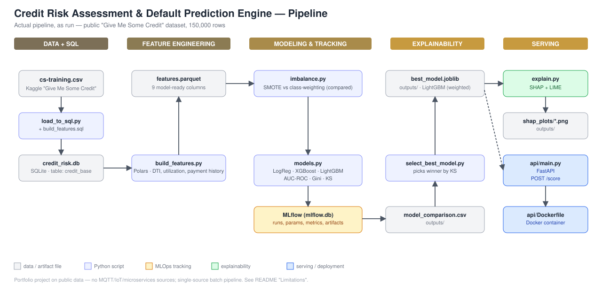
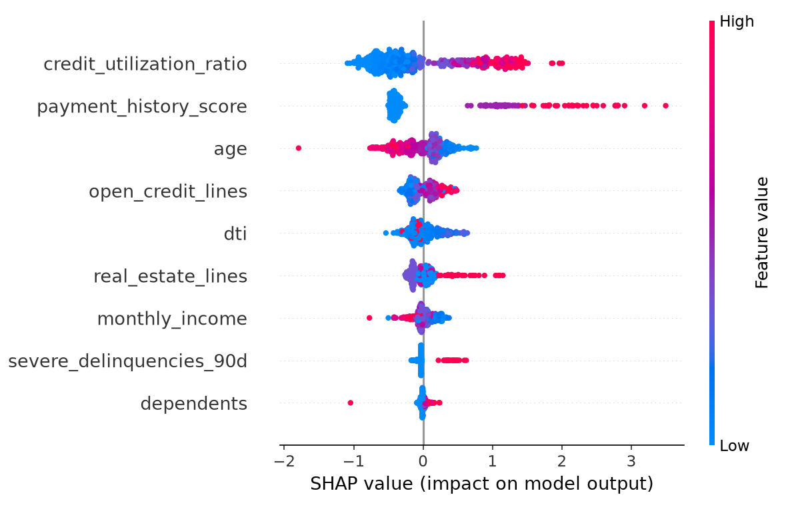
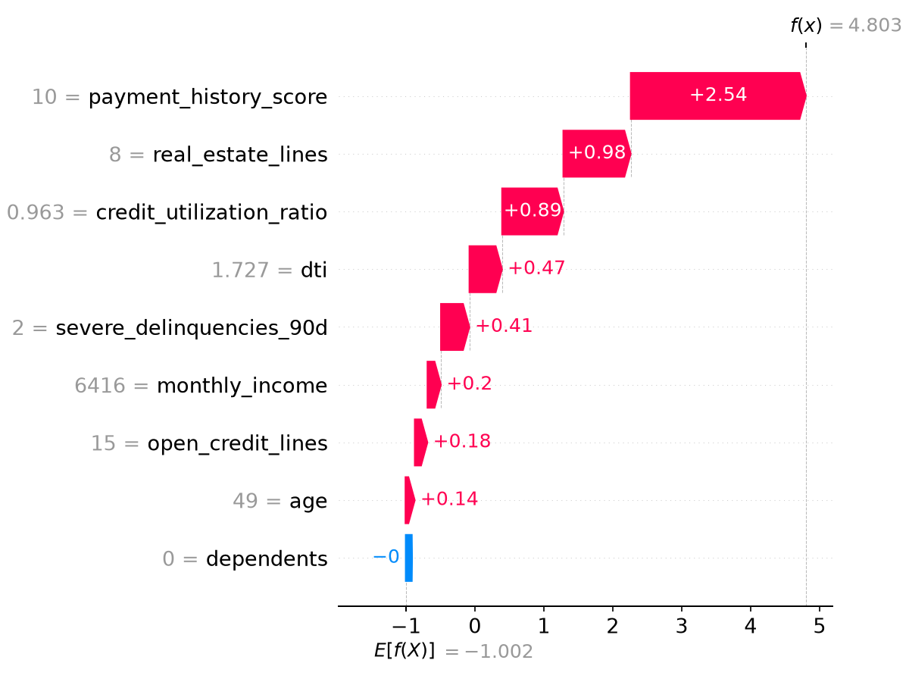
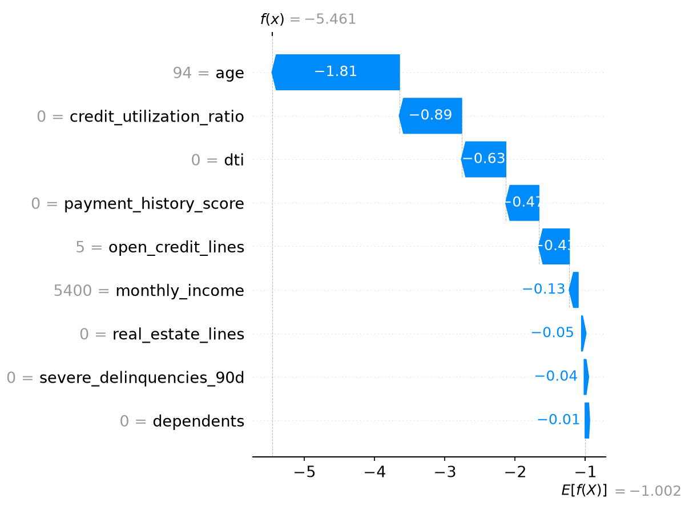

# Open Credit Risk: Assessment & Default Prediction Engine

Predicts the probability of default (PD) of a borrower from financial data, and
explains each accept/reject decision automatically with SHAP — the part that
matters for a regulated lending context, where a black-box score isn't enough.

**This is a portfolio project built on public data, not a real bank deployment.**
See [Limitations](#limitations) before using anything here as evidence of
production-readiness.

> **Note on tooling:** the original brief specified PySpark for the feature
> engineering step. PySpark 4.x needs Java 17 (this machine has Java 11) and
> the compatible 3.5.x line failed a clean install over a slow connection.
> At 150,000 rows this data doesn't need a distributed engine either — using
> Spark here would be the wrong tool for the data size. Swapped to
> **Polars** instead: no JVM, installs in seconds, and is a better-justified,
> genuinely current choice at this scale. See `src/build_features.py`.

## Data

[Kaggle "Give Me Some Credit"](https://www.kaggle.com/c/GiveMeSomeCredit)
(mirrored as a public dataset: `brycecf/give-me-some-credit-dataset`) — 150,000
borrowers, ~6.7% default rate ("SeriousDlqin2yrs"), 10 raw features.

Not committed to this repo (`data/` is gitignored) — the mirror's license is
listed as "unknown" on Kaggle, and the DB/parquet files it produces are
regenerable anyway. Fetch it yourself:
```bash
kaggle datasets download -d brycecf/give-me-some-credit-dataset -p data/raw --unzip
```

## Pipeline



```
data/raw/cs-training.csv
        │  src/load_to_sql.py + sql/build_features.sql
        ▼
data/processed/credit_risk.db  (SQLite, table: credit_base)
        │  src/build_features.py  (Polars)
        ▼
data/processed/features.parquet
        │  src/imbalance.py (SMOTE / class-weighting)
        │  src/models.py    (Logistic Regression, XGBoost, LightGBM)
        │  → tracked in MLflow (./mlflow)
        ▼
outputs/model_comparison.csv, outputs/best_model.joblib
        │  src/explain.py  (SHAP + LIME)
        ▼
outputs/shap_plots/*.png
        │
        ▼
api/main.py  (FastAPI: POST /score → risk score + top SHAP reasons)
        │  api/Dockerfile
        ▼
Docker container
```

## Feature engineering

| Feature | Formula / source | Notes |
|---|---|---|
| Debt-to-Income (DTI) | source `DebtRatio`, clipped to ≤5 | source data has some extreme outliers from near-zero income |
| Credit Utilization Ratio | source `RevolvingUtilizationOfUnsecuredLines`, clipped to [0,1] | source data has a small number of values >1 (data-quality artifact) |
| Payment history score | sum of 30-59d, 60-89d, 90+d late-payment counts, capped at 10 | single number instead of three overlapping ones |
| Income volatility | **not computed** | dataset is a single snapshot per borrower, not a time series — no volatility to measure. Documented here rather than faked with a proxy. |

## Class imbalance

Default rate is ~6.7%. Compared two strategies head-to-head instead of picking
one upfront:
- **SMOTE** oversampling (fit on the training split only, never on test data)
- **Class weighting** (`class_weight="balanced"` / `scale_pos_weight`)

Results and the winning strategy per model are in `outputs/model_comparison.csv`
after running `src/models.py`.

## Models & evaluation

- Logistic Regression (traditional scorecard baseline)
- XGBoost
- LightGBM

Each trained twice — once with SMOTE-resampled data, once with plain class
weighting — evaluated with banking-standard metrics, not just accuracy:
**AUC-ROC**, **Gini coefficient** (`2×AUC − 1`), and the **KS statistic** (max
separation between defaulter/non-defaulter score distributions — the metric
risk teams tend to trust most). Results, from `outputs/model_comparison.csv`
on a 20% held-out test split:

| Model | AUC-ROC | Gini | KS |
|---|---|---|---|
| Logistic Regression (class-weighted) | 0.8588 | 0.7176 | 0.5586 |
| Logistic Regression (SMOTE) | 0.8591 | 0.7182 | 0.5620 |
| XGBoost (class-weighted) | 0.8691 | 0.7383 | 0.5838 |
| XGBoost (SMOTE) | 0.8584 | 0.7168 | 0.5693 |
| **LightGBM (class-weighted)** | 0.8689 | 0.7377 | **0.5840** |

**LightGBM (class-weighted)** wins on KS and is essentially tied with XGBoost
on AUC-ROC/Gini (0.8689 vs 0.8691) — it's the model saved to
`outputs/best_model.joblib` and served by the API. Two findings worth calling
out: **class weighting beat SMOTE for every model** (not the other way
around, which is a common assumption); and the two tree ensembles clearly
beat the logistic-regression baseline (+0.10 AUC, +0.025 KS), while the
baseline itself is far from useless at AUC 0.86.

## Explainability

**Global drivers** (`outputs/shap_plots/shap_summary_global.png`, SHAP summary
plot over a 500-row background sample):



`credit_utilization_ratio` and `payment_history_score` dominate, well ahead of
`age`, `open_credit_lines` and `dti` — exactly the ordering a credit-risk
analyst would expect, and a useful sanity check that the model learned
something sensible rather than an artifact.

**Per-decision explanations** — SHAP waterfall plus an independent LIME
explanation for two real cases from the test set, in the format the brief
asked for:

- **Reject** (client 107594, P(default) = 0.992):
  > *"Payment history (late incidents) = 10.00 increased the predicted risk by
  > 2.541 (SHAP value), the largest single contribution for this
  > application."*
  LIME agrees: its top factor is also `payment_history_score`, weight +0.392.
  

- **Accept** (client 134466, P(default) = 0.004):
  > *"Age = 94.00 decreased the predicted risk by 1.812 (SHAP value), the
  > largest single contribution for this application."*
  LIME agrees on direction: top factor is `payment_history_score <= 0`,
  weight −0.398. This case is the single lowest-risk profile in the dataset,
  and it landed on a genuine outlier (94 years old, zero on every other risk
  factor) rather than a "typical" low-risk borrower — reported as-is rather
  than swapped for a more flattering example.
  

Full LIME reports (interactive HTML): `outputs/shap_plots/lime_reject_example.html`,
`outputs/shap_plots/lime_accept_example.html`.

**SHAP vs LIME agreement:** for both worked examples, SHAP and LIME point to
the same top driver in the same direction — two independent explanation
methods giving a consistent answer is itself evidence the explanation isn't
an artifact of one method's approximation.

## Running it

```bash
pip install -r requirements.txt

python src/load_to_sql.py       # M1/M2 — SQL
python src/build_features.py    # M3 — feature engineering (Polars)
python src/models.py            # M4-M6 — imbalance handling, modeling, MLflow tracking
pytest tests/                   # unit tests for metrics + imbalance logic

# after picking the winning MLflow run and saving it to outputs/best_model.joblib:
uvicorn api.main:app --reload --app-dir .
# or:
docker build -t credit-risk-api -f api/Dockerfile .
docker run -p 8000:8000 credit-risk-api
```

Inspect MLflow runs:
```bash
mlflow ui --backend-store-uri sqlite:///mlflow/mlflow.db
```
(MLflow 3.x deprecated the plain filesystem store in favor of a DB backend —
tracking data lives in `mlflow/mlflow.db`, a local SQLite file.)

## API

`POST /score`
```json
{
  "dti": 0.52,
  "credit_utilization_ratio": 0.8,
  "payment_history_score": 2,
  "severe_delinquencies_90d": 0,
  "monthly_income": 4500,
  "age": 34,
  "open_credit_lines": 6,
  "real_estate_lines": 1,
  "dependents": 1
}
```
→
```json
{
  "probability_of_default": 0.18,
  "decision": "accept",
  "top_reasons": [
    {"feature": "dti", "value": 0.52, "shap_contribution": 0.12, "direction": "increases risk"},
    ...
  ]
}
```

## Limitations

- **Public data, not real bank data.** No claim of business impact (e.g. "reduces
  defaults by X%") is made anywhere in this project — there's no real deployment
  to measure against.
- **No causal validation.** Model performance here is explanatory, on a single
  static snapshot — not validated as forecasting skill on genuinely future data.
- **Income volatility is not computed** — the dataset has no time series per
  borrower, so this feature named in the brief could not be built honestly; see
  the feature-engineering table above.
- **What a real production version would need and doesn't have here**: model
  governance and sign-off, drift monitoring, a champion/challenger process, and
  regulatory documentation (e.g. Basel-style or local-regulator requirements).
